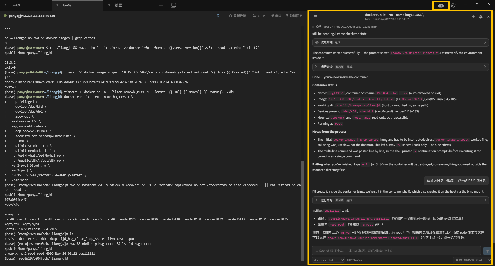

# tabby-copilot

<p align="center">
  <a href="https://www.npmjs.com/package/tabby-copilot"></a>
  <a href="https://tabby.sh/"></a>
  <a href="https://www.deepseek.com/"></a>
  <a href="https://github.com/dadadaguai/tabby-copilot/actions"></a>
  <a href="LICENSE"></a>
</p>

Tabby 终端原生 AI 副驾驶插件 —— **单 Tab 隔离**的 Pi 式 Agent 内核：内嵌在终端右侧的分屏面板，能自主读终端、跑命令（带审批）、发按键、读文件（受白名单约束），真正干活而非一问一答。

- **UI**：Claude / Codex / DeepSeek 风格的极简线性对话流。
- **模型**：多服务商支持（DeepSeek / OpenAI / Claude / Gemini / GLM / Qwen / 腾讯混元…），key 各自填写。
- **隔离**：每个终端 Tab 独立持有会话、屏幕缓冲与文件白名单。

> 参考 [`giejqf/tabby-ai-panel`](https://github.com/giejqf/tabby-ai-panel) 的终端状态机、风险分级、审批模式、上下文预算与会话持久化思路。

## 特性

- **Pi 式 Agent 内核**：8 个工具（`read_terminal` / `run_command` / `send_keys` / `wait_for_output` / `read_file` / `list_dir` / `ask_user` / `focus_terminal`），自主「读 → 想 → 做 → 看结果 → 再修正」闭环，单轮最多 80 次工具调用。
- **命令执行状态机**：8 种退出态（`prompt` / `awaiting_input` / `alt_screen` / `idle` / `timeout` / `reset` / `cancelled` / `matched`），学习 prompt 结束符、剔除命令回显。
- **风险分级 + 审批**：毁灭性命令（`rm -rf /`、`mkfs`、`reboot`…）永远强制确认，4 档审批模式（ask / auto_low / auto_medium / auto_all）。
- **文件白名单**（差异化）：本地 `fs` / SSH SFTP（兜底 `exec cat`/`sed`），路径前缀授权，批准后同目录免确认。
- **会话持久化**：JSON 落盘（原子写）+ 会话抽屉（列表/新建/切换/删除）+ 上下文预算裁剪。
- **HTML 预览**：无需 Tabby 即可在浏览器测流式对话（`npm run preview`）。

## 状态

**v0.2.8** —— PRD 的 8 个里程碑全部完成。见 [PRD](prd.md) 第 8 节路线图。

## 效果预览



## 快速开始

```powershell
npm install
npm run build        # 产物 dist/index.js
npm run typecheck    # 类型检查
npm run test         # 单元测试 + 流式冒烟
npm run preview      # HTML 预览（localhost:8787）
```

## 安装

### 前置要求

- **Node.js**（含 npm）。

### 步骤

1. 克隆仓库：

```powershell
git clone https://github.com/dadadaguai/tabby-copilot.git
cd tabby-copilot
```

2. 安装依赖并打包成 `.tgz`：

```powershell
npm install
npm run build
npm pack          # 生成 tabby-copilot-<版本>.tgz
```

3. 把 `.tgz` 安装到 Tabby 的插件目录（默认 `%APPDATA%\tabby\plugins`）：

```powershell
cd $env:APPDATA\tabby\plugins
npm install "<项目路径>\tabby-copilot-<版本>.tgz" --no-audit --no-fund
```

4. 重启 Tabby，工具栏出现 **Copilot** 按钮（或按 `Ctrl+Alt+A`）。然后在 **Settings → Copilot** 填写 DeepSeek 的 Endpoint / API Key / Model。

## 架构

```text
src/
├── index.ts                  # NgModule 注册
├── config.ts / hotkeys.ts / commands.ts / settings-tab.ts / decorator.ts
├── prompts/system.md         # Agent 内置指令
├── types/                    # config.ts / session.ts
├── core/                     # 无 UI 纯逻辑（可单测）
│   ├── agent.service.ts      # Pi 式工具循环 + 审批 + 会话
│   ├── terminal-runner.ts    # 命令执行状态机
│   ├── terminal-registry.service.ts  # xterm 缓冲读取 + prompt 检测
│   ├── file.service.ts       # 文件读取 + 白名单
│   ├── prompt-builder.ts     # 上下文预算
│   ├── session-store.service.ts # JSON 持久化
│   ├── llm/                  # OpenAI 兼容客户端 + SSE
│   ├── tools/                # 8 个工具定义
│   └── util/                 # prompt-detect / risk / sse / text / ids
└── ui/                       # 面板 / transcript / composer / tool-call / sessions / settings
```

## 测试

- 单元测试：`tests/`（prompt-detect、risk、terminal-runner、file-service、prompt-builder、session-utils、translate-keys），`node --import tsx --test`。
- 流式冒烟：`tests/stream.test.ts` 用 `.env` 的 DeepSeek key 真实流式对话（无 key 自动跳过）。

## 密钥与安全

API key 只保存在 Tabby 的 `config.yaml` 中（或本地预览用的 `.env`，已被 `.gitignore` 忽略），**永不提交进仓库**。参见 `.env.example`。

## 许可证

[MIT](LICENSE)
